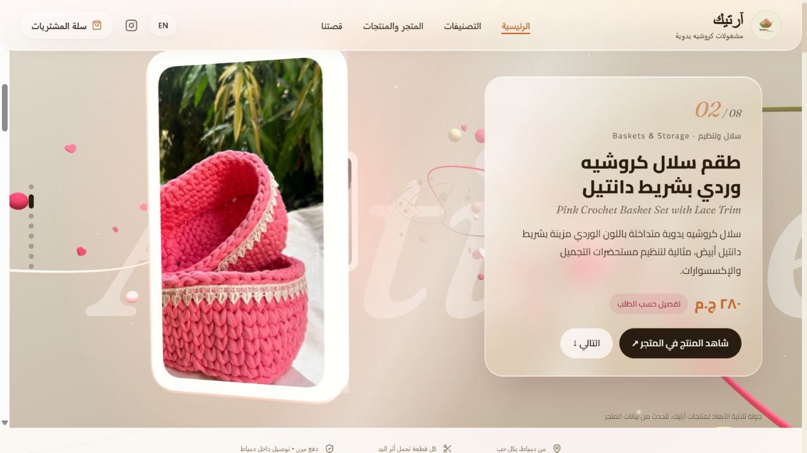

# Artique Store — New Version Showcase

[Live website](https://artique-store.vercel.app/) · [بالعربية](docs/README_AR.md)

A bilingual Arabic/English storefront for handmade crochet products, featuring an interactive Three.js photo tour, a unified liquid glass interface, responsive browsing, product variants, a cart, checkout, and an administration dashboard.

[Explore the current photo tour and glass storefront](https://artique-store.vercel.app/)

## About this repository

This is an independent, sanitized and runnable showcase of the updated Artique Store, maintained by [mn3m2001](https://github.com/mn3m2001). It is based on the public [original showcase repository](https://github.com/mn3m2001/artique-store-showcase), which remains unchanged by this release. It is not the live store's deployment repository and does not contain the private deployment history. Designed and developed with assistance from AI tools.

It includes application source, sample catalog data, automated tests, database schema, and public-facing screenshots. Production customer records, orders, payment proofs, credentials, environment files, database exports, and internal admin screenshots are excluded.

## Experience

- Interactive Three.js photo tour with 3D frames, camera movement, and product photography. It reads published catalog images, current prices and availability on page load; product photography is displayed on 3D frames rather than reconstructed as true 3D product models.
- Cream, blush and champagne backgrounds throughout the storefront, liquid glass navigation and cards, and pointer-driven card tilt with reduced-motion support.
- Arabic RTL and English layouts; mobile navigation and responsive shopping views. Mobile cards keep a fixed square photo area, quick preview, name and price in separate sections, alongside compact filtering controls.
- Categories, filtering, product variants, quantity selection, quick view, and cart.
- Server-calculated checkout totals, stock checks, order access sessions, and payment-proof review flows.
- Product, order, shipping, settings, and review administration.
- Supabase server-side persistence and private media buckets in the production architecture.

## Stack

Next.js App Router · React · TypeScript · Three.js · Tailwind CSS · Supabase · Vitest · Vercel

## Run a local demo

Use Node.js 20.9+ and npm.

```sh
npm ci
npm run setup
npm run dev -- --hostname 127.0.0.1
```

Open http://localhost:3000. Generated local admin credentials are saved in the ignored `LOCAL-ACCESS.txt` file. There is no shared admin password. The setup creates `.env.local` only if it does not exist; do not copy an empty `.env.example` over it.

The demo uses an independent local JSON store, starts without real orders, and does not connect to the live Supabase project. Payment-transfer destinations are blank and disabled in the sample settings. Local order actions affect only your demo data. Credentials for your own Supabase project are optional and must remain in private environment variables.

```sh
npm test
npm run build
npm start
```

Run setup before starting a production build locally so signed sessions have a generated secret. A cloud deployment requires your own Supabase project and server-side configuration; never reuse another store's keys.

## Validation

Validated on 2026-10-15: 18 automated tests passed and the Next.js production build completed successfully. These checks validate this snapshot; they do not constitute a comprehensive security audit.

## Source map

| Area | Location |
| --- | --- |
| 3D scene and storytelling | `src/components/home/` |
| Storefront, checkout, and admin routes | `src/app/` |
| Store logic, local/cloud persistence, sessions | `src/lib/` |
| Private storage and database schema | `supabase/migrations/` |
| Isolated business-logic and session tests | `tests/` |

## Visual review

Review the current [homepage and photo tour](https://artique-store.vercel.app/), [collections](https://artique-store.vercel.app/#categories), and [product catalog](https://artique-store.vercel.app/products) on desktop and mobile. These new screenshots were captured from public pages on 2026-10-15. The older atelier captures in `docs/screenshots` are retained as a previous-design archive.

| Desktop | Mobile |
| --- | --- |
| [Home opening](docs/screenshots-new-version/01-home-desktop.jpg) | [Home opening](docs/screenshots-new-version/05-home-mobile.jpg) |
| [Product-photo tour](docs/screenshots-new-version/02-tour-desktop.jpg) | [Product-photo tour](docs/screenshots-new-version/06-tour-mobile.jpg) |
| [Store cards](docs/screenshots-new-version/03-store-desktop.jpg) | [Store cards](docs/screenshots-new-version/07-store-mobile.jpg) |
| [Product details](docs/screenshots-new-version/04-product-desktop.jpg) | [Product options](docs/screenshots-new-version/08-product-mobile.jpg) |



## Deployment model

The public live website is hosted on Vercel with Supabase-backed store data. The tour reads published products and their images, prices and availability when opened; publishing a product with an image or changing its price is reflected on a page reload. This is a 3D scene displaying product photography, not a scanned or rotatable 3D model of every item.

This repository remains an isolated local demonstration by default. To deploy your own instance, configure your own Supabase project, apply the migrations, set private server environment variables in your host, and verify storage permissions and checkout before accepting orders. Do not use the live store's credentials or real customer data.

Source is published for portfolio review. No software or branding license is granted by this repository; product imagery and branding remain subject to their owners' rights.
